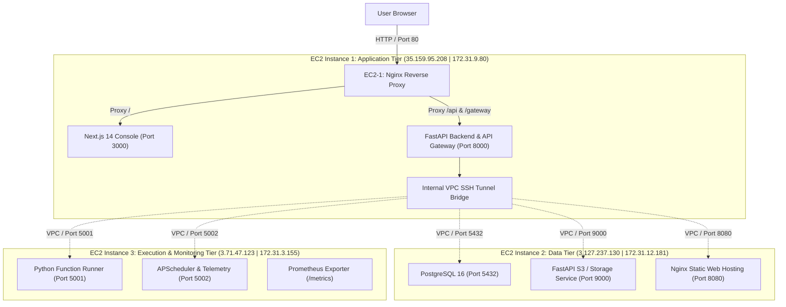

# Mini AWS Cloud Platform

A demonstration of a **Multi-Tier Cloud Platform Architecture** deployed across **exactly 3 AWS EC2 instances**. MiniAWS provides a sleek, modern cyber-themed web console where users can access and manage their own cloud resources with strict per-user quotas.

---

## 🏗️ Architecture Overview



### Multi-Tier Instance Breakdown

| Instance | Role | Public IP |  Services & Ports |
| :--- | :--- | :--- | :--- | :--- |
| **EC2 Instance 1** | **Application Tier** | `35.159.95.208` |  Next.js Frontend (`:3000`), FastAPI Backend & API Gateway (`:8000`), Nginx Proxy (`:80`) |
| **EC2 Instance 2** | **Data Tier** | `3.127.237.130` |  PostgreSQL 16 (`:5432`), S3 Storage Service (`:9000`), Static Web Server (`:8080`) |
| **EC2 Instance 3** | **Execution Tier** | `3.71.47.123` |  Python Function Runner (`:5001`), APScheduler (`:5002`), Prometheus Metrics (`/metrics`) |

---

## 🚀 Key Features

### 1. Storage / File Hosting (S3 Drive)
- **Quota Enforced:** 5 GB storage limit per user.
- **Features:** File uploads, downloads, preview modal (images, code, documents), delete with immediate quota release.
- **Isolation:** Each user's files are isolated in dedicated directories with SHA-256 integrity verification.

### 2. Static Website Hosting
- **Quota Enforced:** Up to 3 websites per user.
- **Features:** Upload HTML/CSS/JS, live in-browser code editor, embedded iframe live preview, generated subpath URLs (`/sites/{user_id}/{site_id}/`).
- **Engine:** Nginx server on EC2 Data Tier with custom routing and caching.

### 3. Serverless Functions (AWS Lambda)
- **Quota Enforced:** Up to 5 serverless functions per user.
- **Features:** Syntax-highlighted code editor for Python 3.9, pre-built templates (Data Processor, Math & Fibonacci, Webhook handler).
- **Execution:** Real-time test runs executing on EC2 Instance 3 with timeout and memory monitoring, displaying stdout, stderr, return value, and sub-millisecond execution duration.
- **Scheduling:** CloudWatch-style background interval triggers (1m, 2m, 5m, 15m, 1h, daily) powered by APScheduler on EC2-3.

### 4. Function Monitoring (CloudWatch Dashboard)
- **Metrics:** Total Invocations, Success Rate %, Average Duration (ms), Error Count.
- **Log Stream:** Searchable, filterable execution logs table with expandable stdout/tracebacks.
- **Infrastructure Health:** Live status of all 3 EC2 tiers (Application, Data, Execution).

### 5. API Gateway
- **Quota Enforced:** Up to 5 API routes and 500 daily requests per user.
- **Configuration:** Custom endpoint path, HTTP method (GET, POST, PUT, DELETE), optional API key authentication (`X-Api-Key`), and rate limiting (requests/min).
- **Live Endpoint:** Routes callable at `/gateway/{user_id}/{route_path}`.
- **Integrated API Tester:** Postman-style in-browser client to test endpoints, query parameters, request bodies, and inspect responses.

### 6. User Quota Governance & Multi-Tenant Support
- Pre-seeded users: **Aarav Sharma** (Developer Plan) and **Sarah Connor** (Starter Plan).
- 1-click user switching in the top bar to demonstrate strict tenant isolation.
- Real-time progress bars tracking Storage, Functions, API Requests, and Website Hosting.

---

## 🛠️ Deployment Instructions

### One-Click Automated Deployment
From your local terminal with `Inst1.pem` present:
```powershell
.\deploy\deploy_all.ps1
```

Or deploy to each instance individually:
1. **EC2-2 (Data Tier):**
   ```bash
   scp -i Inst1.pem -r data_tier deploy/setup_ec2_2.sh ec2-user@3.127.237.130:/home/ec2-user/
   ssh -i Inst1.pem ec2-user@3.127.237.130 "bash setup_ec2_2.sh"
   ```
2. **EC2-3 (Execution Tier):**
   ```bash
   scp -i Inst1.pem -r execution_tier deploy/setup_ec2_3.sh ec2-user@3.71.47.123:/home/ec2-user/
   ssh -i Inst1.pem ec2-user@3.71.47.123 "bash setup_ec2_3.sh"
   ```
3. **EC2-1 (Application Tier):**
   ```bash
   scp -i Inst1.pem Inst1.pem ec2-user@35.159.95.208:/home/ec2-user/
   scp -i Inst1.pem -r backend frontend deploy/setup_ec2_1.sh ec2-user@35.159.95.208:/home/ec2-user/
   ssh -i Inst1.pem ec2-user@35.159.95.208 "bash setup_ec2_1.sh"
   ```

---

## 🌐 Accessing the Console
Open in your browser:
- **Web Console:** `http://35.159.95.208`
- **Backend API Docs:** `http://35.159.95.208/api/docs`
- **API Gateway Invocation:** `http://35.159.95.208/gateway/usr_aarav_sharma/summary`
- **Static Website Hosting:** `http://35.159.95.208/sites/usr_aarav_sharma/site_demo_portfolio/`
